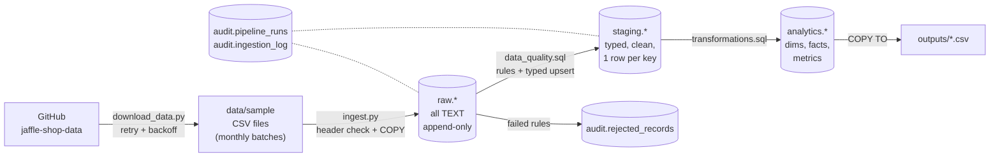
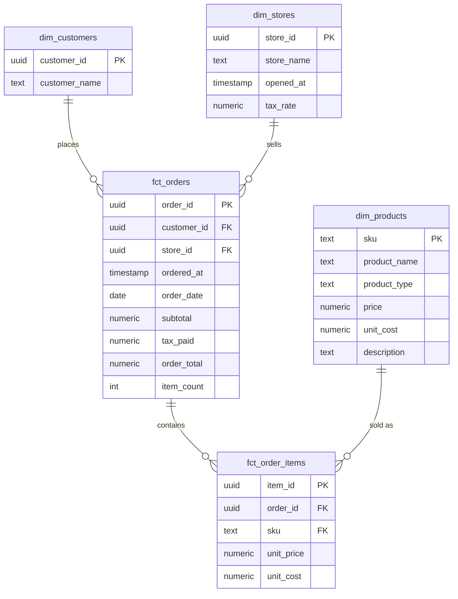

# Architecture and Design Decisions

This document explains **how the pipeline works and why it is built this way**.
For setup and run instructions, see the [README](../README.md).

**In one paragraph:** CSV files are loaded as-is into a `raw` layer. SQL
data-quality rules check every row; bad rows are set aside with a reason, good
rows are cleaned into a `staging` layer. From there a star schema and three
metric tables are built in an `analytics` layer. Every step is logged in an
`audit` layer, and every load is designed so that running it twice gives the
same result.

---

## Technology choices

| Choice | Why |
|---|---|
| **PostgreSQL** | Real primary and foreign keys, CHECK constraints, transactions and `ON CONFLICT` upserts. These are what make the pipeline safe to rerun. Free and runs locally. |
| **SQL for the data logic** | Data-quality rules, cleaning, upserts, metrics and reconciliation all live in `sql/`. The rules are readable in one place and run inside the database, next to the data. |
| **Python only as glue** | Downloads files, checks headers, bulk-loads with `COPY`, runs the SQL files in order, records progress and writes logs. No pandas: the data never needs to sit in Python. |
| **No Airflow, dbt or Docker** | One command runs everything. For 16 small files and a few seconds of work, these tools would add setup without adding reliability. Scheduling uses Windows Task Scheduler or cron (example in the README). |

---

## How data flows

### The building blocks

| Part | What it does | Where |
|---|---|---|
| **Ingestion** | Downloads the source (with retries), checks each file's header, bulk-loads it into `raw` | `src/ingestion/` |
| **Raw layer** | Stores every row as received, all columns as text, plus where it came from (`batch_id`, `source_file`, `row_num`, `loaded_at`) | `raw` schema |
| **Validation** | Runs the data-quality rules; rejected rows go to `audit.rejected_records`, clean rows are typed and loaded into `staging` | `sql/data_quality.sql`, `src/validation/` |
| **Transformation** | Builds dimensions and facts from `staging` and rebuilds the metric tables | `sql/transformations.sql`, `src/transformation/` |
| **Target** | Star schema and metric tables | `analytics` schema |
| **Orchestration** | One command; one transaction per file; tracks which files are done | `src/pipeline/run_pipeline.py` |
| **Testing** | 21 pytest tests on a small hand-checked dataset, in a separate database | `tests/` |
| **Logging and monitoring** | Log file and console; full run and file history; reconciliation checks; freshness check; exit code 1 on failure | `src/pipeline/logger.py`, `audit` schema |

Notes on the raw layer:

- Bad values are kept exactly as received, so a batch can be checked again from `raw` (this happens automatically for batches with held rows). The source CSV files remain the recoverable copy.
- Rows with the wrong number of fields cannot be stored in columns; they are kept as JSON in `audit.rejected_records`.
- Unexpected extra columns are ignored, with a warning in the log.

### What happens in one run

1. Create the tables if they do not exist (`--reset` drops and recreates them).
2. Process the files, parents before children (stores → customers → products → supplies → orders → items). Each file is **one transaction**:
   *hash the file → skip it if already loaded → check the header → load into `raw` → run the data-quality rules → mark it `SUCCESS` → commit.*
3. Re-check older batches that hold rows waiting for a parent record (late-arriving data).
4. Build the `analytics` layer (one transaction) and run the reconciliation checks.
5. Export the CSVs, check freshness and record the result of the run.

---

## Data model

### Layers

| Schema | Contains | Key |
|---|---|---|
| `raw` | Every source row as received, all text | `(batch_id, row_num)` |
| `staging` | Typed, cleaned data; one row per business key | business key, e.g. `order_id` |
| `analytics` | Star schema and metrics, with enforced foreign keys | the stable business keys (UUIDs, product SKU); no surrogate keys |
| `audit` | Runs, file log, rejected records, reconciliation views | `run_id`, `batch_id` |

### Star schema

The three metric tables are rebuilt on every run: `monthly_store_revenue`
(per month and store), `customer_summary` (per customer) and
`monthly_product_sales` (per month and product).

### Modelling decisions

- **Star schema with 3 dimensions and 2 facts.** The data is transactional (orders and items), and the questions are about revenue per month and store, customers and products – a natural fit for facts and dimensions.
- **Two fact tables: one row per order and one row per item.** Order totals (including tax) belong to the order; product sales need one row per item. Keeping both avoids splitting tax across items.
- **`UUID` type for ids.** The source ids are UUIDs. The type rejects malformed ids and stores each in 16 bytes.
- **Money as `NUMERIC(10,2)` dollars.** The source stores whole cents; they are converted once, in staging. `NUMERIC` avoids floating-point rounding errors in sums.
- **Supplies keyed by `(supply_id, sku)`.** The source `id` is not unique: one supply (such as a napkin) is used by several products.
- **Product cost = sum of its supply costs** (`dim_products.unit_cost`). This gives a cost per unit sold, so gross margin can be calculated.
- **Item price captured at first load.** The source has no price per item, so the product's price at load time is stored on the item. A later price change does not rewrite past sales.
- **`item_count` on each order.** Identifies empty orders (no items) so the metrics can leave them out. It is recalculated every run, so items that arrive late update their order.
- **Raw columns are all text.** A bad value (for example `"abc"` as an amount) can still be stored and then rejected with a clear reason, instead of breaking the load.

### Updates and history

- **Today – SCD Type 1:** dimensions keep only the latest value. The source has no change history, and the metrics only need current names.
- **If history were needed – SCD Type 2:** for example, product prices would get `valid_from`, `valid_to` and `is_current` columns. A price change closes the current row and adds a new one, and sales join to the version that was valid when the order was placed. Not built, because the source cannot show a price change.
- **Corrected facts:** a corrected order in a later file replaces the existing row (same `order_id`), and the metrics are rebuilt, so the correction flows through. This is covered by a test.

---

## Data quality

### Issues found in the source data

| Finding | File | How it is handled |
|---|---|---|
| Supply `id` is not unique on its own | `raw_supplies` | Composite key `(supply_id, sku)` |
| A product name has a trailing space (`"for richer or pourover "`) | `raw_products` | Whitespace is trimmed and collapsed in staging |
| Amounts are in whole cents | orders, products, supplies | Converted to dollars in staging |
| Timestamps have no time zone | orders, stores | Stored as local shop time (documented assumption) |
| Items have no quantity or price | `raw_items` | One row = one unit; price taken from the product |
| 125 orders have a total of 0 and **no items** | `raw_orders` | Loaded, flagged as `EXCEPTION`, left out of the order metrics |
| Tax is 1 cent lower than expected on 939 of 15,774 orders | `raw_orders` | Accepted as the source system's rule (see below) |

**About the 1-cent tax difference:** for example, 6% of $19.00 is $1.14, but the
source has $1.13. All 15,774 orders match `trunc(subtotal_dollars × tax_rate × 100)`
calculated in floating point – the source system truncates instead of rounding.
This is what customers paid, so it is accepted. The quality check compares
`subtotal + tax_paid` with `order_total`, and those always match.

### Three categories of problems

| Category | Meaning | Loaded? |
|---|---|---|
| **INVALID** | The row is broken and cannot be used (missing field, wrong type, negative amount, duplicate) | No |
| **INVESTIGATE** | The row may be fine but needs a person or more data (unknown customer that may arrive later, order before the store opened, totals that don't add up) | No – held and re-checked on every run |
| **EXCEPTION** | Unusual but legitimate (zero-value order, 1-cent rounding) | Yes – loaded and flagged |

### The rules

All row rules live in `sql/data_quality.sql`.

**INVALID – the row is rejected**

| Rule | Applies to | Meaning |
|---|---|---|
| `malformed_row` | all | Wrong number of fields (recorded by `ingest.py`) |
| `missing_required` | all | A required field is empty (spaces and tabs count as empty) |
| `invalid_uuid` | stores, customers, orders, items | An id is not a valid UUID |
| `invalid_timestamp` | stores, orders | Not a valid date-time starting with an ISO date |
| `invalid_amount` | products, supplies, orders | Not a whole number of cents in plain digits (PostgreSQL would also accept `0x10` or `1_000`) |
| `amount_out_of_range` | products, supplies, orders | Above 9,999,999,999 cents, which would overflow the column |
| `invalid_key` | products, supplies | SKU or supply id longer than 50 characters (very long keys would exceed PostgreSQL's index size and fail the whole file) |
| `invalid_tax_rate` | stores | Not a number between 0 and 1 |
| `invalid_boolean` | supplies | `perishable` is not true/false |
| `negative_amount` | products, supplies, orders | An amount below zero |
| `duplicate_key` | all | Same key twice in one file; later copies are rejected (UUIDs are compared in normal form, so `{…}` and upper case match) |

**INVESTIGATE – the row is held**

| Rule | Applies to | Meaning |
|---|---|---|
| `unknown_customer`, `unknown_store` | orders | The customer or store does not exist (yet) |
| `unknown_order` | items | The order does not exist yet (may arrive later) |
| `unknown_product` | items, supplies | The SKU does not exist |
| `before_store_opened` | orders | The order is dated before the store opened |
| `total_mismatch` | orders | `subtotal + tax_paid` differs from `order_total` by more than 1 cent |

**EXCEPTION – the row is loaded and flagged**

| Rule | Applies to | Meaning |
|---|---|---|
| `total_rounding` | orders | The totals differ by exactly 1 cent |
| `zero_value_order` | orders | The order total is zero |

### File-level checks

These happen in `ingest.py`, before any row is loaded:

- **The whole file fails** (nothing loaded, logged as `FAILED` with the error) if a required column is missing or duplicated, the file cannot be opened, or it is not valid UTF-8 text (or contains NUL bytes).
- **An extra column** is ignored, with a warning.
- **An empty file** is logged as `EMPTY` (if it has a header, the header is still checked).
- **Blank lines** are skipped. A line of only commas is treated as a row of empty values and rejected.

Each rejected record stores the batch, row number, rule, a readable reason
(including the bad value) and the original row as JSON, so it can be
investigated without opening the file.

### Reconciliation

Two database views check that nothing is lost or counted twice:

- **`audit.batch_reconciliation`** – per file: rows read = rows accepted + rows rejected, and every source row is in `raw` or recorded as malformed. Accepted rows are counted independently, so this is a real check.
- **`audit.layer_reconciliation`** – 8 checks from staging to facts to metrics: counts, revenue totals, units, and **order subtotal = sum of its item prices**.

Both are exported to `outputs/` on every run. If any layer check fails, the run is marked `FAILED`.

---

## Metrics

**1. Monthly store revenue** (`monthly_store_revenue`) – per calendar month and store:
- `order_count` = number of non-empty orders
- `revenue` = sum of `order_total`
- `avg_order_value` = revenue ÷ order_count

**2. Customer summary** (`customer_summary`) – per customer with at least one non-empty order:
- first and last order date, `order_count`
- `lifetime_value` = sum of `order_total`
- `is_repeat_customer` = more than one order

**3. Monthly product sales** (`monthly_product_sales`) – per calendar month and product:
- `units_sold` = number of item rows
- `revenue` = sum of item prices (before tax)
- `total_cost` = sum of supply costs
- `gross_margin` = revenue − total_cost

**Assumptions that affect the numbers**

- Revenue in metrics 1 and 2 **includes tax** (what the customer paid). Metric 3 is **before tax**, because tax is charged per order, not per product.
- Empty orders (no items) are left out of metrics 1 and 2. They all have a total of 0, so revenue is unaffected, but order counts and average order value are not inflated.
- Only rows that passed data quality (including EXCEPTION rows) are counted. INVALID and INVESTIGATE rows are left out until they are fixed.
- Months are based on `ordered_at` as given (no time-zone conversion).
- The sample covers Sep 2016 – Feb 2017, when only the Philadelphia store was open.

---

## Incremental processing and recovery

The source has **no change tracking** – no "updated at" column and no change
feed. The pipeline uses two mechanisms instead.

**1. Files are recognised by their content.**
Each file's SHA-256 hash is stored in `audit.ingestion_log`. A file whose hash
was already loaded successfully is skipped. A unique index on
`file_hash WHERE status = 'SUCCESS'` makes loading the same content twice
impossible, even if the code had a bug. A new or changed file has a new hash
and is loaded.

**2. Records are matched on their business key.**
Every load into staging and analytics is an upsert
(`INSERT … ON CONFLICT (key) DO UPDATE … WHERE … IS DISTINCT FROM …`):

- the same record twice gives one row,
- a corrected record replaces the old one,
- re-running the same batch rewrites nothing.

Each staging row also remembers the newest batch that delivered it, and an
update is only allowed when `existing.batch_id <= new.batch_id`. So
re-processing an **older** batch (for example when held rows are re-checked)
can never overwrite newer data.

### Questions and answers

**How does the pipeline know what is already processed?**
By the file hash with status `SUCCESS` (or `EMPTY`) in `audit.ingestion_log`.

**How are duplicates prevented?**
Three layers: the file checkpoint (same file), primary keys with upserts (same
record in different files) and the `duplicate_key` rule (same record within
one file).

**How are corrections applied?**
A later file with the same key overwrites the row – the most recently loaded
batch wins, and an older batch never overwrites a newer one. Metrics are
rebuilt on every run. One exception: a file whose exact content was loaded
before is skipped, so changing a file back to an earlier version needs
`--reset` (see [Known limitations](../README.md#known-limitations)).

**Where is the progress stored?**
In `audit.ingestion_log` (one row per file) and `audit.pipeline_runs` (one row per run).

**How are failures detected?**
Any error in a file rolls back that file's transaction and records it as
`FAILED` with the error message. The run is marked `FAILED` and exits with
code 1. The run result is written in a `finally` block on a fresh database
connection, so even a lost connection or Ctrl+C is recorded as `FAILED`.

**What if two runs start at once?**
Each run takes a PostgreSQL advisory lock. A second run is refused and exits with code 1.

**How do you recover?**
Run the same command again. The failed file never reached `SUCCESS`, so it is
retried; files that succeeded are skipped.

**What about late-arriving records?**
A row whose parent has not arrived (for example an item before its order) is
held as `INVESTIGATE`. Every run re-checks the held rows and loads those whose
parent now exists. Demonstrated: a failed orders file left 3,442 items held;
the next run loaded the orders and then the items.

**Why one transaction per file?**
A file's raw rows, data-quality results and staging rows are committed together
or not at all, so a crash never leaves half a file behind. The transformations
run afterwards in their own transaction; they give the same result every time,
so if they fail, the next run simply runs them again.

---

## Testing

`tests/test_pipeline.py` has **21 tests**. Each runs the real pipeline on a
small dataset whose results were calculated by hand, in a separate
`jaffle_test` database.

They cover: schema checks (including a **deliberately invalid input**),
invalid-record handling and categories, duplicates and corrections,
referential integrity, reconciliation, metric correctness, safe reruns,
failure recovery, empty and blank input, and run safety (concurrent and
interrupted runs, unreachable database, missing files).

The full list is in the [README](../README.md#tests). Latest result:
`outputs/test_results.txt` (21 passed).

---

## Performance, observability and reliability

**Measured** (see `outputs/benchmark.txt`): a full run of the 6-month sample
(39,599 rows) takes **~12 s** on a laptop, and a run with no new files **~2 s**.
Anything marked *"At larger scale"* below is a proposal, not implemented.

### Memory and partitioning
- **Now:** one file is processed at a time. It is read fully into memory and sent to PostgreSQL with one `COPY`, so peak memory is about 6× the file size (measured once with a generated 82 MB, 1M-row file: ~530 MB). Monthly files keep each batch small.
- **At larger scale:** read files in chunks; partition `raw` and the fact tables by month, so old partitions stay untouched and can be archived.

### SQL optimisation and indexing
- **Now:** primary keys on every business key; indexes on the fact foreign keys and `order_date`; `raw` is keyed by `(batch_id, row_num)`, so each batch is read through the index; unchanged rows are skipped (`IS DISTINCT FROM`).
- **At larger scale:** check heavy queries with `EXPLAIN ANALYZE`; replace the per-row safe-cast functions (the main cost of validation) with set-based checks; rebuild only the months a batch affects.

### Batch or distributed processing
- **Now:** a single machine is enough. Validation runs at roughly 4,500–5,500 rows/s (varies between runs); a generated 1M-row file loaded in about 3 minutes (measured once). The full public dataset is only about 4× the sample.
- **At larger scale:** Spark or a cloud warehouse would only pay off at hundreds of millions of rows. The same layered design and SQL would carry over.

### Retries and controlled failure
- **Now:** downloads retry 3 times (after 2 s and 4 s). Data errors are never retried blindly: bad rows are rejected with a reason, and a bad file fails on its own and is retried on the next run.
- **At larger scale:** let the scheduler retry the whole run a limited number of times, then alert.

### Logging and monitoring
- **Now:** every step logs the time, level, component, file, batch id, counts and duration to `outputs/logs/pipeline.log` and the console. The full history can be queried in `audit.pipeline_runs`, `audit.ingestion_log` and `audit.rejected_records`.
- **At larger scale:** JSON log lines sent to a log platform, and a dashboard on the audit tables (rejection rate per rule, run duration).

### Freshness and completion
- **Now:** each run records its status and file counts; reconciliation must pass; the freshness check logs the newest order and warns when it is older than `monitoring.freshness_max_age_days` (switched off for this historical sample).
- **At larger scale:** a check that the expected files arrived each day (for example, alert if no orders file came in).

### Alerting, recovery and support
- **Now:** exit code 1 on failure lets any scheduler raise an alert; recovery is "fix the cause, run the same command again" (see the failure table in the README).
- **At larger scale:** an orchestrator such as Airflow with one task per stage, and alerts for failed runs, failed reconciliation, high rejection rates or stale data.
