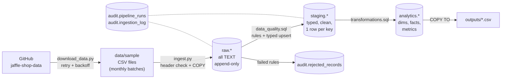
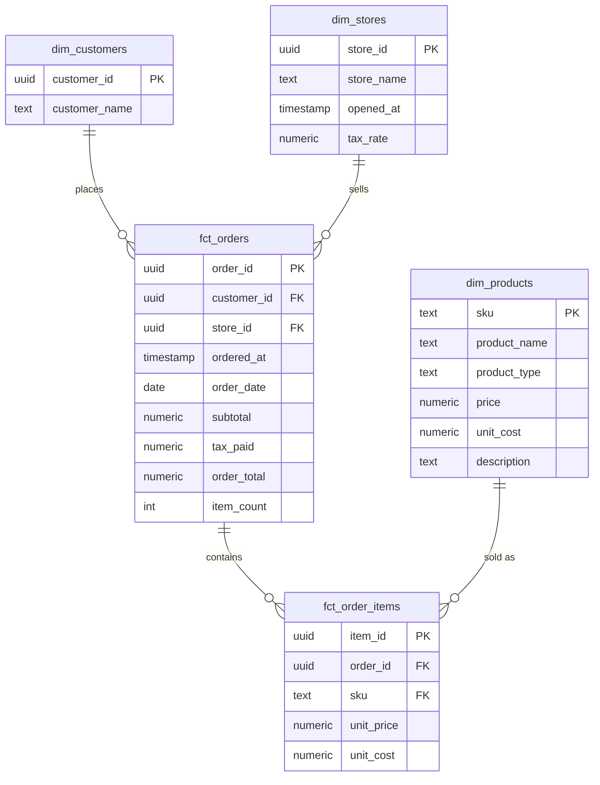

# Architecture and Design Decisions

This document explains how the pipeline is built and why. Setup and run
instructions are in the [README](../README.md).

---

## 1. Overview

A batch ELT pipeline that loads the public **Jaffle Shop** CSV files into
**PostgreSQL**, validates them, and builds a star schema with three metric
tables.

| Choice | Why |
|---|---|
| **PostgreSQL** | Real primary/foreign keys, CHECK constraints, transactions and `ON CONFLICT` upserts, which are what make the pipeline safe to rerun. Free, runs locally. |
| **SQL for the logic** | Data-quality rules, cleaning, upserts, metrics and reconciliation are all SQL (`sql/`), so the rules are readable in one place and run inside the database, next to the data. |
| **Python as thin glue** | Downloads files, checks headers, bulk-loads with `COPY`, runs the SQL files in order, records checkpoints and logs. No pandas: the data never needs to be held in Python. |
| **No orchestrator / dbt / Docker** | One command runs everything. For six source files and a few seconds of processing, Airflow or dbt would add setup without adding reliability. Section 8 explains how it would be scheduled. |

---

## 2. Data flow

| Layer | Component | Where |
|---|---|---|
| Source and ingestion | Download with retries; per-file header check; `COPY` into raw | `src/ingestion/` |
| Raw storage | One table per source, every column `TEXT`, plus `batch_id`, `source_file`, `row_num`, `loaded_at`. Nothing is lost on load, so any batch can be re-processed from here. | `raw` schema |
| Validation | SQL rules write failures to `audit.rejected_records`; clean rows are cast and upserted into staging | `sql/data_quality.sql`, `src/validation/` |
| Transformation | Dimensions and facts upserted from staging; metrics rebuilt | `sql/transformations.sql`, `src/transformation/` |
| Target | Star schema + metric tables | `analytics` schema |
| Orchestration | One CLI; per-file transactions; checkpoint by file hash | `src/pipeline/run_pipeline.py` |
| Testing | 9 pytest tests on a hand-checked fixture dataset in a separate database | `tests/` |
| Logging and monitoring | Log file + console; run and file history in `audit`; reconciliation views; freshness check; exit code 1 on failure | `src/pipeline/logger.py`, `audit` schema |

**Order of work in one run**

1. Create the schema if it does not exist (`--reset` recreates it).
2. For every file, parents before children (stores, customers, products, supplies, orders, items), in **one transaction per file**:
   hash → skip if already loaded → header check → `COPY` to raw → `data_quality.sql` → mark `SUCCESS` → commit.
3. Re-check batches holding `INVESTIGATE` rows (late-arriving parents).
4. Run `transformations.sql` (one transaction) and check `audit.layer_reconciliation`.
5. Export CSVs, check freshness, record the run result.

---

## 3. Data model

### Schemas

| Schema | Purpose | Keys |
|---|---|---|
| `raw` | Exact copy of each file, all `TEXT` | `(batch_id, row_num)` |
| `staging` | Typed, cleaned, one row per business key | business key (e.g. `order_id`) |
| `analytics` | Star schema and metrics, with enforced foreign keys | surrogate-free: business keys are stable UUIDs |
| `audit` | Runs, file log, rejected records, reconciliation views | `run_id`, `batch_id` |

### Analytics model

Metric tables (rebuilt every run): `monthly_store_revenue (month, store_id)`,
`customer_summary (customer_id)`, `monthly_product_sales (month, sku)`.

### Modelling decisions

| Decision | Reason |
|---|---|
| Star schema: 3 dimensions, 2 facts | The data is transactional (orders and items), so facts and dimensions fit the questions asked: revenue by month/store, customers, products. |
| Two fact grains: order and item | Order totals (with tax) live on the order; product sales need one row per item. Keeping both avoids splitting tax across items. |
| `UUID` type for ids | The source ids are UUIDs; the type rejects malformed ids and stores them in 16 bytes. |
| `NUMERIC(10,2)` dollars | Source amounts are integer cents; converted once in staging. `NUMERIC` avoids floating-point rounding in sums. |
| Supplies keyed by `(supply_id, sku)` | The source `id` is **not unique**: one supply (e.g. a napkin) is used by several products. |
| `dim_products.unit_cost` = sum of supply costs | Gives a cost per unit sold, so gross margin can be calculated. |
| Item price captured at first load | The source has no item price. The product's price at load time is stored on the item, so a later price change does not rewrite past sales. |
| `fct_orders.item_count` | Identifies empty orders (no items) so metrics can exclude them; recalculated every run, so late items update their order. |
| Raw columns are all `TEXT` | A bad value (e.g. `"abc"` as an amount) can still be stored and then rejected with a reason, instead of failing the load. |

### Updates and history

* **Current approach - SCD Type 1:** dimensions keep only the latest value
  (`ON CONFLICT ... DO UPDATE`). The source has no change history, and the
  metrics only need current names.
* **If history were needed - SCD Type 2:** for example, product price changes
  would add `valid_from`, `valid_to` and `is_current` to `dim_products`; a
  change closes the current row and inserts a new one, and facts join on the
  version valid at `ordered_at`. Not implemented because the source cannot
  show a price change.
* **Corrected facts:** a corrected order arriving in a later file replaces the
  existing row (same `order_id`), and the metrics are rebuilt, so the
  correction flows through (covered by a test).

---

## 4. Data quality

### Issues found in the source data

| Issue | Where | Handling |
|---|---|---|
| `id` is not unique on its own | `raw_supplies` | Composite key `(supply_id, sku)` |
| Trailing space in a name (`"for richer or pourover "`) | `raw_products` | `TRIM` and collapse repeated spaces in staging |
| Amounts stored as integer cents | orders, products, supplies | Converted to dollars (`/ 100.0`) in staging |
| Timestamps without a time zone | orders, stores | Stored as `TIMESTAMP` (local shop time); documented assumption |
| No item quantity or price | `raw_items` | One row = one unit; price taken from products |
| 125 orders with total 0 and **no items** | `raw_orders` | Loaded, flagged as `EXCEPTION`, excluded from order metrics |
| `tax_paid` is 1 cent below `subtotal × tax_rate` on 939 of 15,774 orders (e.g. 6% of $19.00 = $1.14, source has $1.13). All 15,774 match `trunc(subtotal_dollars × tax_rate × 100)` in floating point, so the source system truncates a float instead of rounding | `raw_orders` | Accepted as the source's rule (customers paid that amount). The data-quality check compares `subtotal + tax_paid` with `order_total`, which always match |

### Three categories

| Category | Meaning | Loaded? |
|---|---|---|
| **INVALID** | The row is broken and cannot be used (missing field, wrong type, negative amount, duplicate) | No |
| **INVESTIGATE** | The row may be correct but needs a person or more data (unknown customer that may arrive later, order before the store opened, totals that do not add up) | No - held, and re-checked on every run |
| **EXCEPTION** | A legitimate but unusual business case (zero-value order, 1-cent rounding) | Yes - loaded and flagged |

### Rules (all in `sql/data_quality.sql`)

| Rule | Tables | Category |
|---|---|---|
| `malformed_row` - wrong number of fields (recorded by `ingest.py`) | all | INVALID |
| `missing_required` - required field empty | all | INVALID |
| `invalid_uuid` | stores, customers, orders, items | INVALID |
| `invalid_timestamp` - must start with an ISO date and parse | stores, orders | INVALID |
| `invalid_amount` - must be whole cents | products, supplies, orders | INVALID |
| `invalid_tax_rate` - number between 0 and 1 | stores | INVALID |
| `invalid_boolean` | supplies | INVALID |
| `negative_amount` | products, supplies, orders | INVALID |
| `duplicate_key` - same key twice in one file (first kept) | all | INVALID |
| `unknown_customer`, `unknown_store` | orders | INVESTIGATE |
| `unknown_order` (may be late), `unknown_product` | items, supplies | INVESTIGATE |
| `before_store_opened` | orders | INVESTIGATE |
| `total_mismatch` - `subtotal + tax_paid` differs from `order_total` by more than 1 cent | orders | INVESTIGATE |
| `total_rounding` - differs by exactly 1 cent | orders | EXCEPTION |
| `zero_value_order` | orders | EXCEPTION |

File-level checks in `ingest.py`: a **missing required column** fails the
whole file (nothing loaded, logged as `FAILED`); an **extra column** is logged
as a warning and ignored; an **empty file** is logged as `EMPTY`.

Each rejected record stores the batch, file row number, rule, a readable
reason (including the bad value) and the original row as JSON, so it can be
investigated without opening the file.

### Reconciliation

* `audit.batch_reconciliation` - per file: `rows_read = rows_accepted + rows_rejected`, and every source row is in raw or recorded as malformed.
* `audit.layer_reconciliation` - 8 checks from staging to facts to metrics: counts, revenue totals, units, and **order subtotal = sum of item prices**.

Both are exported to `outputs/` on every run; any failed layer check marks the run `FAILED`.

---

## 5. Metrics

| # | Table | Definition |
|---|---|---|
| 1 | `monthly_store_revenue` | Per calendar month and store: `order_count` = non-empty orders; `revenue` = sum of `order_total`; `avg_order_value` = revenue / order_count |
| 2 | `customer_summary` | Per customer with at least one non-empty order: first and last order date, `order_count`, `lifetime_value` = sum of `order_total`, `is_repeat_customer` = more than one order |
| 3 | `monthly_product_sales` | Per calendar month and product: `units_sold` = item rows; `revenue` = sum of item prices (pre-tax); `total_cost` = sum of supply cost; `gross_margin` = revenue - total_cost |

**Assumptions that affect the results**

* Revenue in metrics 1 and 2 **includes tax** (it is what the customer paid); metric 3 is **pre-tax**, because tax is charged per order, not per product.
* Empty orders (no items) are excluded from metrics 1 and 2. In this data they all have a total of 0, so revenue is unaffected but order counts and average order value are not inflated.
* Only rows that passed data quality (or are EXCEPTION) are counted; INVALID and INVESTIGATE rows are excluded until fixed.
* Months use `ordered_at` as given (no time-zone conversion).
* The sample covers Sep 2016 - Feb 2017, when only the Philadelphia store was open.

---

## 6. Incremental processing and recovery

The source has **no change tracking** (no `updated_at`, no change feed), so
the pipeline uses two alternatives:

1. **File-level: content hash as the checkpoint.** Each file's SHA-256 is
   stored in `audit.ingestion_log`. A file whose hash was already loaded
   successfully is `SKIPPED`; a partial unique index
   (`file_hash WHERE status = 'SUCCESS'`) makes a double load impossible even
   if the code had a bug. A new or changed file has a new hash and is loaded.
2. **Record-level: business-key upserts.** Every load into staging and
   analytics is `INSERT ... ON CONFLICT (key) DO UPDATE ... WHERE ... IS DISTINCT FROM ...`.
   The same record twice gives one row; a corrected record replaces the old
   one; an unchanged record is not even rewritten.

| Question | Answer |
|---|---|
| How is processed data identified? | File hash with status `SUCCESS` in `audit.ingestion_log`. |
| How are duplicates prevented? | Checkpoint (same file) + primary keys and upserts (same record in different files) + `duplicate_key` rule (same record within a file). |
| How are corrections applied? | A later file containing the same key overwrites the row (latest file wins); metrics are rebuilt every run. |
| Checkpoint / state? | `audit.ingestion_log` (per file) and `audit.pipeline_runs` (per run). |
| How are failures detected? | Any error in a file rolls back that file's transaction and records `FAILED` with the error message; the run is marked `FAILED` and the process exits with code 1. |
| How are failures recovered? | Run the same command again. The failed file never reached `SUCCESS`, so it is retried; files that succeeded are skipped. |
| Late-arriving records? | A child whose parent has not arrived (e.g. an item before its order) is held as `INVESTIGATE`. Every run re-checks held batches and loads the rows whose parent now exists. Demonstrated: a failed orders file left 3,442 items held; the next run loaded the orders and then the items. |

**Why per-file transactions:** raw load, data-quality results and staging
rows of a file are committed together or not at all, so a crash never leaves
half a file behind. Transformations run afterwards in their own transaction;
they are idempotent, so if they fail the next run simply runs them again.

---

## 7. Testing

`tests/test_pipeline.py` - 9 tests, each running the real pipeline on a small
dataset whose metrics were calculated by hand:

| Test | Area |
|---|---|
| file missing a required column is rejected | schema compliance, **deliberately invalid input** |
| invalid rows rejected with rule and category | expected behaviour for invalid records |
| corrected record updates instead of duplicating | business-key uniqueness, corrections |
| no orphan records reach the facts | referential integrity |
| reconciliation balances with rejected rows | record-count and aggregate reconciliation |
| metrics match hand-calculated values | transformation correctness |
| rerun skips loaded files and changes nothing | idempotency |
| failed file is rolled back and recovered | failure detection and recovery |
| empty file is logged and does not fail the run | empty input |

Results: `outputs/test_results.txt` (9 passed).

---

## 8. Performance, observability and reliability

Measured numbers are in `outputs/benchmark.txt`: a full run of the
6-month sample (39,599 rows) takes **~10 s** on a laptop, and a rerun with
no new files **~1.6 s**. Everything below marked *proposal* is not
implemented.

| Topic | Current solution | At larger scale (*proposal*) |
|---|---|---|
| **Memory and partitioning** | Files are streamed to PostgreSQL with `COPY`; Python never holds more than one file. Data is already split into monthly batches. | Read files in chunks; range-partition `raw` and the fact tables by month so old partitions are untouched and can be archived. |
| **SQL optimisation and indexing** | Primary keys on every business key; indexes on fact foreign keys and `order_date`; `(batch_id, row_num)` key on raw so each batch is read by index; unchanged rows skipped by `IS DISTINCT FROM`. | Check heavy queries with `EXPLAIN ANALYZE`; replace per-row PL/pgSQL safe casts (the main cost in validation) with set-based regex checks; rebuild only the affected months of metrics instead of all. |
| **Batch or distributed processing** | Single-node batch is enough: the measured rate is ~6,000 rows/s for validation and the full public dataset is only ~4x the sample. | Spark or a cloud warehouse would only be justified at hundreds of millions of rows; the same layered design and SQL would carry over. |
| **Retry and controlled failure** | Downloads retry 3 times with backoff (2 s, 4 s). Data errors are never retried blindly: bad rows are rejected with a reason, bad files fail alone and are retried on the next run. | Scheduler-level retry of the whole run with a limit, then alert. |
| **Structured logging and monitoring** | Every step logs timestamp, level, component, file, batch id, counts and duration to `outputs/logs/pipeline.log` and the console. Full history is queryable in `audit.pipeline_runs`, `audit.ingestion_log` and `audit.rejected_records`. | JSON log lines shipped to a log platform; a dashboard on the audit tables (rejection rate per rule, run duration). |
| **Freshness and completion** | Run status (`SUCCESS`/`FAILED`) with file counts; reconciliation must pass; freshness check logs the newest order and warns when it is older than `monitoring.freshness_max_age_days` (disabled for this historical sample). | Expected-files check per day (e.g. alert if no orders file arrived). |
| **Alerting, recovery and support** | Exit code 1 on failure lets any scheduler alert; recovery is "fix the cause, run the same command again". See the runbook in the README. | Schedule with Windows Task Scheduler or cron (or an Airflow DAG with one task per stage); alert on failed run, failed reconciliation, rejection rate above a threshold, or stale data. |
